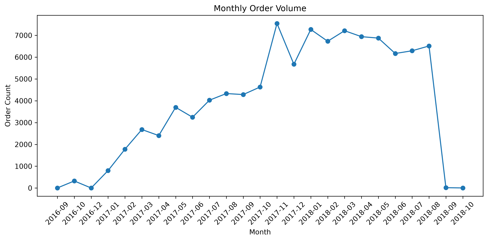

# Olist 电商订单分析与延迟风险预测

基于 Kaggle 公开的 **Brazilian E-Commerce Public Dataset by Olist**，完成订单级数据整理、配送延迟探索性分析，以及订单获批时的延迟风险预测。项目使用 Python、Pandas、SQL 和 scikit-learn，比较简单基线、逻辑回归和随机森林，并分析分类阈值、误报与漏报。

> **项目定位：** 数据分析与离线建模练习，而非已上线的配送预警系统。最终模型为**未加权随机森林**，测试集 AP 为 **0.0848**，高于同一测试集延迟率基线 **0.0428**；但 Precision 较低，尚不能认为具备可靠的实际业务预警能力。

## 1. 数据来源与预测任务

- **数据来源：** [Kaggle — Brazilian E-Commerce Public Dataset by Olist](https://www.kaggle.com/datasets/olistbr/brazilian-ecommerce)
- **数据时间范围：** 2016—2018 年，约 10 万笔原始订单。
- **使用的三张原始数据表：**
  - `olist_orders_dataset.csv`：订单及关键时间戳。
  - `olist_order_items_dataset.csv`：商品明细、价格、运费及卖家 ID。
  - `olist_customers_dataset.csv`：客户地区及关联信息。
- **分析粒度：** 一行代表一笔订单；商品明细先按 `order_id` 聚合，再与订单、客户表关联。
- **预测时点：** 订单获批时（`order_approved_at`）。
- **延迟标签 `is_delayed`：** 实际送达的**日历日期**晚于预计送达日记为 1，否则为 0；同一天送达记为 0。无法确定送达结果的样本不直接视为未延迟。

实际送达时间仅用于生成标签和控制历史标签可用性，不进入模型特征。预计送达日用于构造 `promised_days`，前提是假设该预计日期在订单获批时已知。

## 2. 项目完成内容

1. **数据整理与质量检查：** 检查订单重复、时间字段及缺失情况，按订单聚合商品明细，构建订单级数据集。
2. **探索性分析（EDA）：** 分析订单时间趋势、不同客户州的延迟率，以及订单金额等因素与延迟的关联。相关统计表和图表位于 `reports/`。
3. **预测任务设计：** 按获批时间划分训练、验证、测试数据；在训练和验证阶段限制标签可观察时间。
4. **模型对比：** `DummyClassifier` 基线、逻辑回归及未加权随机森林。
5. **模型评估与解释：** AP、Precision、Recall、F1、PR 曲线、分类阈值、误报与漏报，以及置换特征重要性。

**EDA 图表示例——月度订单量趋势：**



其他分析汇总见 [`reports/amount_delay_summary.csv`](reports/amount_delay_summary.csv) 和 [`reports/state_delay_summary.csv`](reports/state_delay_summary.csv)。

## 3. 主要建模结果

### 3.1 数据划分

根据 `order_approved_at` 约按 70% / 15% / 15% 设定时间边界，并考虑训练、验证样本的标签可用性：

| 数据集 | 订单数 | 延迟率 |
|---|---:|---:|
| 训练集 | 64,381 | 6.82% |
| 验证集 | 12,544 | 4.30% |
| 测试集 | 14,456 | 4.28% |

### 3.2 验证集模型对比

| 模型 | 输入特征数 | AP | Precision | Recall | F1 | 分类阈值 |
|---|---:|---:|---:|---:|---:|---:|
| DummyClassifier（prior） | 9（不实际使用） | 0.04297 | 0 | 0 | 0 | 默认规则 |
| Logistic Regression | 9 | 0.06865 | 0.0650 | 0.4100 | 0.1122 | 0.08 |
| **Random Forest（未加权）** | **8** | **0.11372** | **0.1535** | 0.2876 | **0.2001** | 0.07474 |

AP 反映风险排序效果，不依赖单一分类阈值。逻辑回归与随机森林的分类阈值分别在验证集上选择，且使用的特征集合不同；因此这是实际项目配置的比较，并非严格控制其他因素的纯算法对照实验。

### 3.3 最终随机森林测试集

最终采用未加权 `RandomForestClassifier`：`n_estimators=120`、`max_depth=10`、`min_samples_leaf=30`、`max_features="sqrt"`、`random_state=42`。

| 指标 | 测试集结果 |
|---|---:|
| 订单数 | 14,456 |
| 延迟率（随机排序 AP 基线） | 0.0428 |
| Average Precision（AP） | **0.0848** |
| Precision | 0.0962 |
| Recall | 0.4604 |
| F1 | 0.1591 |

测试集分类使用在验证集确定的阈值 `0.07474`。虽然 AP 高于随机排序基准，但误报较多，尚不适用于未经进一步验证的实际业务预警。

### 3.4 主要实验发现

- 加入 `promised_days`（预计配送天数）后，验证集 AP 从 **0.06974** 提升至 **0.11127**（特征消融实验）。
- 构造了卖家历史延迟率和历史订单数，但实验中没有带来额外改善，因此未纳入最终模型。
- 验证集置换重要性显示，`customer_state` 和 `promised_days` 对模型的 AP 影响较大；重要性不代表因果关系。
- 类别权重对照中，`class_weight="balanced"` 的验证集 AP 略高，但最佳 F1 未提高，最终仍保留原来的未加权模型。

完整结果见 [`reports/experiments.md`](reports/experiments.md)。

## 4. 仓库结构

```text
olist-delivery-risk/
├── data/                              # 本地数据，不在 GitHub 中分发
│   ├── raw/                           # Olist 原始 CSV
│   └── processed/                     # 清洗和建模的中间数据
├── src/
│   ├── check_data.ipynb
│   ├── data_feature_item_groupby.ipynb
│   ├── merge_orders.ipynb
│   ├── explore_orders.ipynb
│   ├── prediction_task.ipynb
│   ├── baseline_and_logistic_regression.ipynb
│   ├── random_forest.ipynb
│   ├── check_orders.py
│   └── branch_test.py                 # 协作练习文件
├── models/
│   └── random_forest_v1.joblib       # 已保存的随机森林及预处理配置
├── reports/
│   ├── figures/
│   │   └── monthly_orders.png
│   ├── data_quality.md
│   ├── amount_delay_summary.csv
│   ├── state_delay_summary.csv
│   └── experiments.md
├── sql/
│   ├── 01_data_preparation.sql
│   ├── 02_data_validation.sql
│   ├── 03_order_analysis.sql
│   └── 04_delivery_delay_analysis.sql
├── .gitignore
├── requirements.txt
└── README.md
```

## 5. 环境配置与运行

建议使用 Python 3.10 或更新版本，在 VS Code 中安装 Python、Jupyter 扩展，并选择项目虚拟环境作为 Notebook Kernel。安装依赖前请确保 `requirements.txt` 已覆盖 Notebook 实际使用的包。

**Windows PowerShell：**

```powershell
python -m venv venv
.\venv\Scripts\Activate.ps1
pip install -r requirements.txt
```

**macOS / Linux：**

```bash
python3 -m venv venv
source venv/bin/activate
pip install -r requirements.txt
```

运行步骤：

1. 从 [Kaggle 数据集页面](https://www.kaggle.com/datasets/olistbr/brazilian-ecommerce) 下载三张原始 CSV，放入项目根目录的 `data/raw/`。
2. 在 VS Code 中打开项目根目录并选择虚拟环境。
3. 按数据检查、商品聚合、订单关联、EDA、建模数据构造的流程运行 `src/` 下对应 Notebook。
4. 确认 `data/processed/model_dataset.csv` 和 `data/processed/orders_with_delay.csv` 已生成后，运行 `src/baseline_and_logistic_regression.ipynb` 和 `src/random_forest.ipynb`。
5. 核对模型输出与 [`reports/experiments.md`](reports/experiments.md) 中的结果。

**复现说明：** 仓库不包含原始 CSV；Notebook 之间存在数据文件依赖，以上是依据代码整理的运行流程，目前尚未完成独立干净环境的端到端复现验证。

## 6. 局限性

- 延迟订单占比低，Precision 较低且误报较多；Accuracy 不能作为唯一评价指标。
- 训练、验证与测试来自不同时期；测试集 AP 低于验证集，存在时间泛化问题。
- 训练、验证样本排除了各自边界时点前尚未送达的订单，可能引入选择偏差。
- 项目只使用三张原始表，缺少商家地理位置、真实承运过程等信息。
- `promised_days` 依赖“预计送达日期在获批时已知”的假设，数据缺少完整历史业务快照。
- 测试集评估结果已经被查看，后续不宜反复用该测试集进行模型选择。